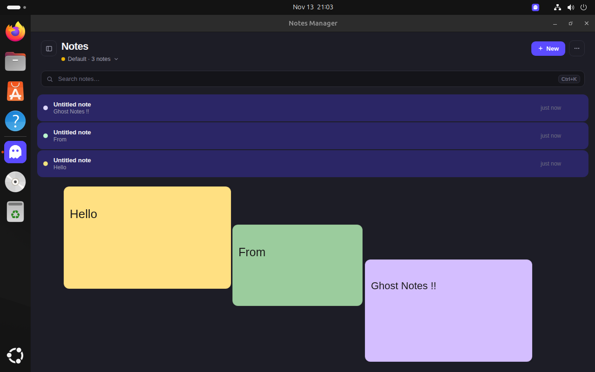
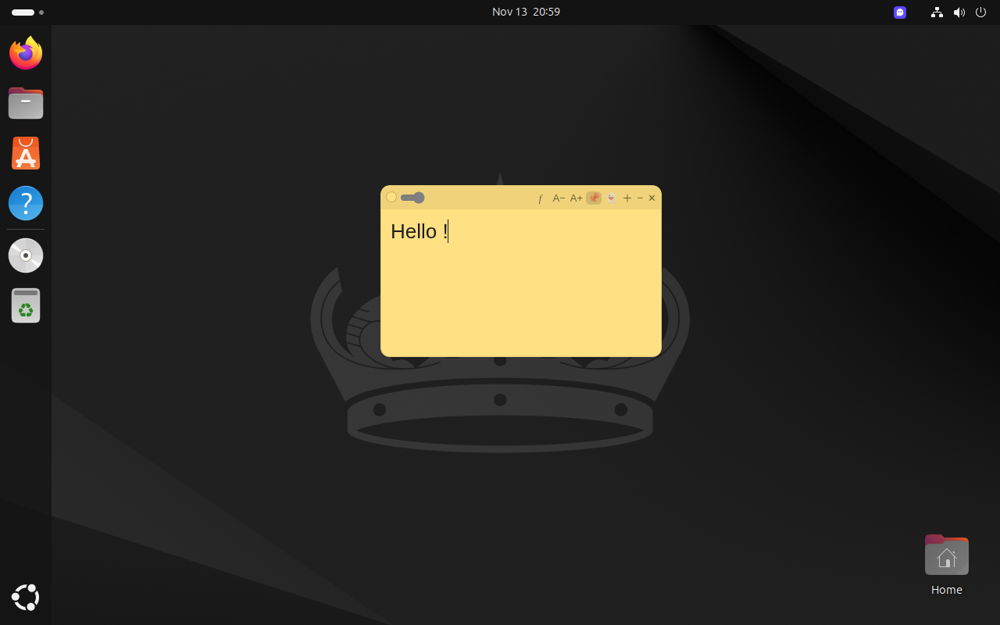

<p align="center">
  
</p>

<h1 align="center">Ghost Notes for Ubuntu</h1>

<p align="center">
  <b>Your thoughts, close at hand.<br />Your notes, out of the shared view.</b>
</p>

<p align="center">
  
  
  
  <a href="LICENSE"></a>
</p>

<p align="center">
  <a href="#see-it-on-ubuntu">Screenshots</a> ·
  <a href="#install-the-ubuntu-preview">Install</a> ·
  <a href="#make-it-yours">Features</a> ·
  <a href="#tested-on-ubuntu">Compatibility</a> ·
  <a href="#the-people-behind-ghost-notes">Credits</a>
</p>

Keep reminders, meeting prompts and ideas in floating notes above your desktop.
On the supported Ubuntu setup, Ghost Notes stays visible to you while the
screen-sharing capture shows the content behind your private notes.

This Ubuntu integration brings [Navya Bijoy’s original Ghost Notes](https://github.com/navyabijoy/invisible-notes)
and its familiar interface to GNOME, with Linux capture exclusion and mouse
interaction fixes by Nandith Narayanan.

<p align="center">
  
  <br />
  <sub>Your notes together. A little colour for every thought.</sub>
</p>

## See it on Ubuntu

One small note can hold the next thing you need to remember. Keep it nearby,
adjust its size and opacity, or pin it above your other apps.

<p align="center">
  
  <br />
  <sub>Navya’s original note interface, running inside the Ubuntu test VM.</sub>
</p>

These screenshots were taken in the Ubuntu VM. They show the local interface;
screen-sharing exclusion is verified separately through capture tests.

## Make it yours

| Feature               | What you can do                                                              |
| --------------------- | ---------------------------------------------------------------------------- |
| Floating notes        | Move and resize notes around your desktop.                                   |
| Colours and opacity   | Give notes a colour and let the desktop show through.                        |
| Formatting            | Adjust text styling and size from the note toolbar.                          |
| Workspaces and search | Organise notes into workspaces and find them in the manager.                 |
| Pin                   | Keep a note above other applications.                                        |
| Ghost mode            | Click through the note body while keeping its toolbar usable.                |
| Capture exclusion     | Keep private notes out of supported Mutter/PipeWire screen-sharing captures. |
| Keyboard shortcuts    | Choose modifier-based shortcuts for common actions.                          |
| Local storage         | Save notes locally, with encryption through GNOME libsecret when available.  |

**Ghost mode controls mouse clicks.** Screen-sharing invisibility is handled by
the Ubuntu capture integration; you do not need to turn on ghost mode to hide a
private note from supported captures.

## Install the Ubuntu preview

**The latest Navya-design installer is tested locally and has not yet been
published as a public release.** Source code and shared release work live in
[Nandith’s Ghost Notes fork](https://github.com/Nandith-0777/invisible-notes).

Once you have the matching `.deb` file, install it with Ubuntu’s package manager.
For the Navya-design package currently used in the test VM:

```sh
cd ~/Downloads
sudo apt install ./ghost-notes-ubuntu_navya-ui_amd64.deb
```

1. Save your work and restart Ubuntu after installation.
2. Open **Ghost Notes** from the application launcher.
3. Create a note, then check the captured view before using private content in a call.

The installer includes Electron, the app and the matching capture companion.
Ubuntu’s package manager installs the declared runtime dependencies. You do not
need Git, Node.js, npm or a compiler to use the packaged app.

<details>
<summary><b>Remove the preview</b></summary>

```sh
sudo apt remove ghost-notes-ubuntu
```

Restart Ubuntu afterward. Removal restores the original Mutter library;
personal notes remain in your profile.

</details>

<details>
<summary><b>Run or build from source</b></summary>

Use the current shared source, including the tested original UI:

```sh
git clone --branch test/navya-ui-omarchy https://github.com/Nandith-0777/invisible-notes.git
cd invisible-notes
npm ci
npm start
```

These commands run the app. They do not install Ubuntu capture exclusion by
themselves. To build the full Ubuntu installer on the supported Ubuntu target:

```sh
npm run dist:ubuntu
```

See the [Ubuntu packaging guide](https://github.com/Nandith-0777/invisible-notes/blob/test/navya-ui-omarchy/packaging/ubuntu/README.md)
for build requirements and companion details.

</details>

## Tested on Ubuntu

| Component       | Verified setup                                      |
| --------------- | --------------------------------------------------- |
| Ubuntu          | Desktop 24.04.5 LTS                                 |
| Architecture    | amd64 / x86-64                                      |
| Desktop session | GNOME 46 on Wayland; app through XWayland           |
| Mutter          | `46.2-1ubuntu0.24.04.18`                            |
| Test machine    | Ubuntu VM, software rendering, one display, scale 1 |

The installer is tied to the exact supported Mutter revision. Support for other
Ubuntu releases, compositor revisions and ARM64 is not established by this test.

| Check                         | Result                                                                                      |
| ----------------------------- | ------------------------------------------------------------------------------------------- |
| Google Meet                   | Invisibility manually verified in the Ubuntu VM during earlier integration testing.         |
| Latest Navya UI capture check | Private note capture matched the unobstructed background exactly: **zero differing bytes**. |
| Ghost toolbar recovery        | A real mouse click successfully switched ghost mode off.                                    |
| Pin                           | Toggled successfully in both directions.                                                    |
| Normal profile                | GNOME libsecret encryption active; global shortcut registration confirmed.                  |
| Application tests             | **136 passed · 7 skipped · 0 failed** for the tested UI source.                             |

[Read the latest Ubuntu verification report](https://github.com/Nandith-0777/invisible-notes/tree/test/navya-ui-omarchy/validation/navya-ui-ubuntu-20261113)
· [Earlier capture and rollback tests](validation/ubuntu-gnome-20261112/README.md)

Zoom, physical GPU capture, multiple displays and fractional scaling still need
independent verification on Ubuntu. Ordinary screenshots and direct X11/KMS
capture are outside this exclusion. The Notes Manager remains visible in captures.

## A few useful details

**How does invisibility work?** The Ubuntu integration modifies Mutter’s capture
path so private note windows are omitted from supported screen-sharing frames.
Your local desktop still draws the notes normally. The app checks the companion’s
version and active session before reporting capture protection available.

**Can I click through a note and turn it off again?** Yes. Ghost mode lets
clicks pass through the body while the toolbar remains interactive. Click the
ghost icon again to return to normal editing.

**Does the ghost button make a note visible to the meeting?** No. It controls
mouse interaction. Navya’s restored toolbar does not include the extra
screen-sharing visibility button from the saved redesigned interface.

**Ubuntu asks to unlock a keyring.** Unlock your existing GNOME keyring with its
own password to allow access to encrypted notes. The keyring password can differ
from your login password.

## The people behind Ghost Notes

| Developer                                                               | Contribution                                                                                        |
| ----------------------------------------------------------------------- | --------------------------------------------------------------------------------------------------- |
| **[Navya Bijoy](https://github.com/navyabijoy)** · Main developer       | Created Ghost Notes / Invisible Notes and its original application and interface.                   |
| **[Nandith Narayanan](https://github.com/Nandith-0777)** · Co-developer | Linux and Omarchy integration, Ubuntu GNOME capture support, installer work, and Linux input fixes. |

The original project history and attribution are preserved. The app uses the
[Apache 2.0 license](LICENSE); the modified Mutter component retains its upstream
licensing and corresponding-source requirements.

<p align="center">
  <sub>Built on Ghost Notes. Brought to Ubuntu.</sub>
</p>
